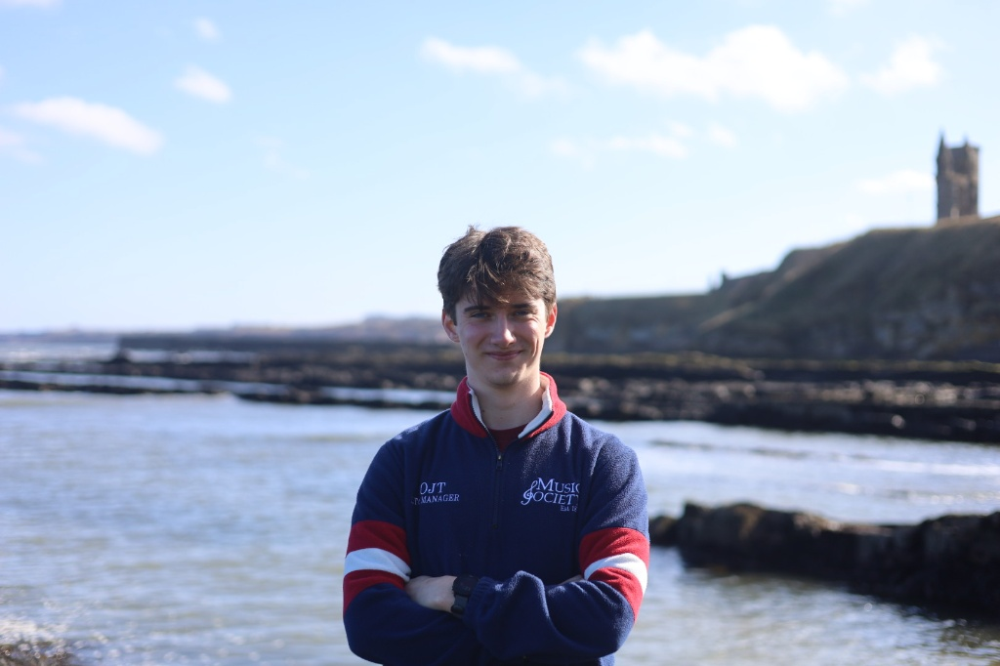

# Welcome!

I'm a Member of Technical Staff at [Machenta](https://machenta.com/), a robot learning lab in London, where I work on robot foundation model training. Previously I studied for an [MSc Artificial Intelligence](https://www.imperial.ac.uk/computing/prospective-students/courses/pg/mai/) at [Imperial College London](https://www.imperial.ac.uk/), and Mathematics and Theoretical Physics at the [University of St Andrews](https://www.st-andrews.ac.uk/).

Currently reading *Austerlitz* by W. G. Sebald and listening to Bruckner's Symphony No. 8.

[CV](/cv.pdf) · [LinkedIn](https://www.linkedin.com/in/owain-thorp-202a45242/) · [GitHub](https://github.com/ojlt) · &#91;first&#93;.&#91;last&#93; @ proton.me
